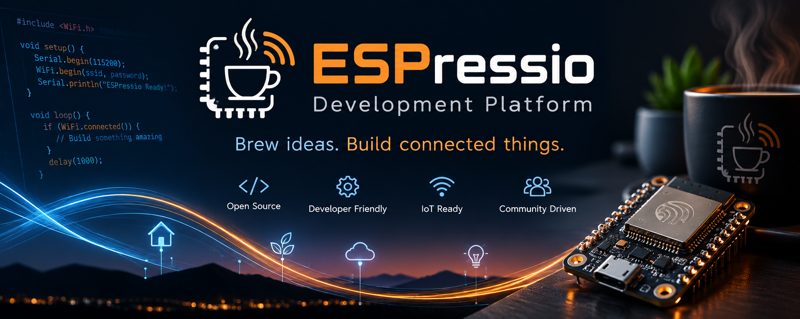

# Thursday, November 19th 2026
Today sees the public availability of `EDP-Logging` and its supporting libraries, now that they have been hardened, durability-verified, and deemed ready for real-world use.

The ESPressio Logging components provide a high-efficiency means of capturing valuable diagnostic information with minimal performance impact or storage overhead.

ESPressio Logging provides multiple Log Sinks "in the box", including UART (Serial) live output, and durable persisted Flash storage solutions.

Next to release will be `EDP-Profiling`, which provides efficient and durable Profiling and Metrics capabilities for embedded applications (useful for identifying problematic bottlenecks and inefficiencies within your codebase).
